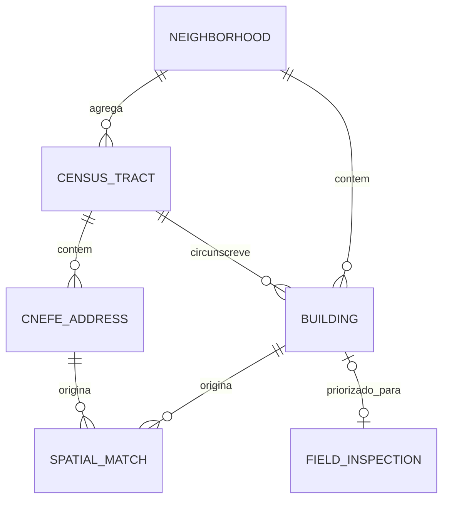

# Atlas Urbano de Paulo Afonso — MVP

Visualizador de **edificações reais** sobre um mapa interativo, aplicado a Paulo Afonso/BA. O sistema cruza fontes abertas (polígonos de prédios do Overture Maps, com o OpenStreetMap como fallback, e endereços do CNEFE/IBGE), grava o resultado num banco espacial e o expõe por uma API REST (tiles vetoriais para o mapa, GeoJSON para detalhe e agregados), consumida por um frontend com mapa 3D em níveis de detalhe, busca, filtros por tipo de uso, cartão do prédio e relatório exportável.

> **Retrato estatístico, não cadastro oficial.** Pegada de edificação ≠ área construída, e *footprint* ≠ terreno. Os números refletem as fontes usadas (CNEFE 2022, Overture e OSM) e herdam as limitações delas (ver [Limitações conhecidas](#limitações-conhecidas)).

## Equipe

Projeto da turma de Sistemas de Informação, Paulo Afonso – BA.

| Função | Nome |
| --- | --- |
| Líder da equipe | Caio Lúcio |
| Membro | Arthur Henrique |
| Membro | Elliton Luís |
| Membro | Rafael Santos |
| Membro | Luís Gustavo |
| Membro | João Almeida |

Repositório: <https://github.com/NOXXD-COMPANY/ATLAS-PAULO-AFONSO>

## Sumário

1. [Problema e objetivo](#problema-e-objetivo)
2. [Fluxo do sistema](#fluxo-do-sistema)
3. [Dados usados](#dados-usados)
4. [Como rodar](#como-rodar)
5. [Arquitetura](#arquitetura)
6. [API](#api)
7. [Modelo de dados](#modelo-de-dados)
8. [Testes](#testes)
9. [Requisitos e estado de implementação](#requisitos-e-estado-de-implementação)
10. [Casos de uso](#casos-de-uso)
11. [Decisões de engenharia](#decisões-de-engenharia)
12. [Limitações conhecidas](#limitações-conhecidas)
13. [Roadmap](#roadmap)
14. [Estrutura do repositório](#estrutura-do-repositório)

---

## Problema e objetivo

Nenhuma fonte aberta responde sozinha à pergunta *"o que existe em cada prédio da cidade e onde ele está?"*:

- o **Overture Maps** (e, como complemento, o **OpenStreetMap**) fornece a **forma** (polígono) de cada edificação, com pouca informação de uso;
- o **CNEFE (IBGE)** fornece **endereço e espécie do estabelecimento** (residencial, comercial, religioso etc.), mas apenas como pontos.

O projeto integra as fontes: cada ponto de endereço é associado, por relação espacial, à edificação que o contém. O polígono vem do Overture (ou do OSM, onde o Overture não tem) e o tipo de uso vem do IBGE. O resultado serve para consulta por usuários não técnicos e como base para estatísticas por recorte territorial e, futuramente, para priorizar conferência de campo.

## Fluxo do sistema

```
dados abertos: Overture + OSM (polígonos) · QG/CNEFE (endereços)
        ↓
    ETL em Python (import_data.py)
        ↓
    MariaDB/MySQL (tabela espacial `buildings`)
        ↓
    FastAPI
      /api/map/meta · /api/map/overview · /api/tiles/{z}/{x}/{y}.pbf   (mapa)
      /api/buildings/{id} · /api/search · /api/stats                   (detalhe, busca, relatório)
        ↓
    React + MapLibre GL (tiles vetoriais, 3D) sobre o mapa base OpenFreeMap
        ↓
          MAPA
```

## Dados usados

| Fonte | O que fornece | Volume |
| --- | --- | --- |
| `overture-...-building-*.geojson` (janela) + `...-building-municipio.geojson` (município inteiro, mesma release) | Polígono real de cada edificação | 52.809 prédios no município (8.382 na janela original) |
| `qg_810_endereco_*.json` (CNEFE/IBGE, município 2924009) | Endereços e estabelecimentos | 61.965 pontos |
| `osm_buildings_paulo_afonso.geojson` (2ª fonte, via API Overpass/OSM, aberta e sem login) | Polígonos onde o Overture não cobre | 400 prédios (fallback; nenhum endereço novo foi adotado, pois o Overture municipal já cobria) |

A tabela `buildings` tem uma linha por endereço QG (61.965) mais os prédios sem nenhum endereço, totalizando **87.951 registros**. 58.178 endereços (93,9%) caíram em polígono; restam 3.787 círculos ("bolinhas") de endereços sem prédio.

**Fluxo de carga com as duas fontes de polígonos:**

1. Os arquivos do Overture são unidos (sem duplicar IDs) e recortados no contorno do município (`municipio_boundary.geojson`).
2. Cada endereço é associado a um polígono do Overture.
3. Os endereços que sobraram tentam um polígono do OSM (se o arquivo existir; sem ele, o fallback é só desligado).
4. O que ainda sobrar vira círculo de ~5 m.

**Regras da junção espacial endereço × edificação** (a mesma para as duas fontes):

1. Se o ponto está **dentro** de um polígono, usa esse polígono.
2. Se não, procura polígonos a até **~15 m** (tolerância para porta na fachada ou erro de GPS).
3. Havendo mais de um candidato, escolhe o **mais próximo**.
4. Endereço sem prédio vira um **círculo de ~5 m** ao redor do ponto.

**Tipo de uso**, em ordem de prioridade:

1. código de espécie do QG: `1`=residencial, `2`=hospedagem, `3`=agropecuário, `4`=institucional, `5`=serviço, `6`=comercial, `8`=religioso; `7` (em construção) vira `desconhecido`;
2. subtipo do Overture (ex.: `residential`, `commercial`, `religious`);
3. classe do Overture, ou a tag `building` do OSM tratada como classe (ex.: `house`, `retail`, `church`);
4. `desconhecido`.

IDs de endereço duplicados no CNEFE recebem sufixo `#n`, e polígonos do OSM sem endereço entram com ID `osm-<id>`.

### Dados brutos (não versionados)

A pasta `data/raw/` está no `.gitignore`, então **quem clona o repositório precisa obter os arquivos**:

| Arquivo | Caminho | Como obter |
| --- | --- | --- |
| Overture (janela e município) | `data/raw/overture/` | A documentar (origem e parâmetros do download) |
| CNEFE/QG | `data/raw/qg/qg_810_endereco_Munic2924009.json` | A documentar (download do IBGE) |
| Contorno do município | `data/raw/municipio_boundary.geojson` | A documentar (origem) |
| OSM (opcional) | `data/raw/osm/osm_buildings_paulo_afonso.geojson` | `scripts/fetch_osm_buildings.py` |

## Como rodar

Pré-requisitos: **Python 3.10 ou superior** (a API usa a sintaxe `str | None`), Node.js, e o `mariadb`/`mariadbd` do sistema já instalados (não precisa rodar o MariaDB como serviço, pois o script sobe uma instância local). Os arquivos de dados brutos devem estar em `data/raw/` (ver acima).

```bash
# 1) Ambiente Python (uma vez)
python3 -m venv .venv
./.venv/bin/pip install -r backend/requirements.txt

# 2) Instalar o app (uma vez)
cd frontend && npm install && cd ..

# 3) Tudo de uma vez (usa dados existentes; importe só quando necessário)
bash scripts/run.sh
```

Para atualizar os dados já importados, rode `bash scripts/run.sh --reimport`.

Ou passo a passo:

```bash
# (opcional, demora vários minutos) baixa a 2ª fonte de polígonos do OSM
./.venv/bin/python scripts/fetch_osm_buildings.py

bash scripts/db.sh start            # sobe o MariaDB local (:3307, db atlas_urbano)
./.venv/bin/python import_data.py   # importa e relaciona os dados
./.venv/bin/uvicorn backend.main:app --host 127.0.0.1 --port 8000 &
cd frontend && npm run dev -- --port 5173 &
```

Abra **http://127.0.0.1:5173/**. Para parar o banco: `bash scripts/db.sh stop`.

**Portas e serviços**

| Serviço | Endereço |
| --- | --- |
| MariaDB local | `127.0.0.1:3307` (banco `atlas_urbano`) |
| Backend FastAPI | `http://127.0.0.1:8000` (docs interativas em `/docs`) |
| Frontend Vite | `http://127.0.0.1:5173` |

**Logs:** `/tmp/atlas-uvicorn.log` (backend), `/tmp/atlas-vite.log` (frontend) e `.mysql-data/mysql.err` (banco).

**Configuração**

- Banco (backend): `backend/config.py` (lê `DB_HOST`, `DB_PORT`, `DB_USER`, `DB_PASSWORD`, `DB_NAME` e `DB_SSL_CA` do ambiente; sem `DB_SSL_CA`, conecta sem TLS como no ambiente local).
- Auth: `JWT_SECRET` (obrigatório em produção) e `JWT_EXPIRE_MINUTES` (padrão 480) no ambiente; o front manda `Authorization: Bearer` em toda rota `/api`.
- Banco (carga): constantes no topo de `import_data.py`. **Atenção:** hoje elas apontam para uma instância diferente da que o `db.sh` sobe (porta e usuário distintos), e a credencial está escrita no arquivo. Alinhar com `config.py` e mover para variáveis de ambiente (ver [Limitações conhecidas](#limitações-conhecidas)).
- Frontend: a variável `VITE_API_URL` define o endereço da API (padrão `http://127.0.0.1:8000`).
- CORS: o backend aceita apenas `localhost:5173` e `127.0.0.1:5173`.

### Camada de conferência CNEFE rooftop (local, sem API externa)

O `cnefe_rooftop.py` é o shim do motor ativo, `algoritmo_raycast.py`: usa quadra/face do CNEFE para lançar raios da rua para dentro do quarteirão e achar o prédio de cada endereço. A versão clássica (pré direção-IBGE/evidências) fica preservada em `cnefe_rooftop_classico.py`; compare os dois motores com `scripts/comparar_algoritmos.py <cnefe> <edificacoes>`. Para rodar fora do backend:

```bash
./.venv/bin/pip install -r requirements-rooftop.txt
./.venv/bin/python cnefe_rooftop.py data/raw/qg/qg_810_endereco_Munic2924009.json \
  data/raw/overture/overture-2026-08-19.0-building-municipio.geojson \
  data/processed/pontos_rooftop.gpkg --debug --web-geojson data/processed/pontos_rooftop.geojson
```

- `--debug` grava `<saida>.debug.gpkg` (uma camada por etapa, com antes/depois) e `<saida>_debug/*.csv` (`resumo_etapas.csv`, raios, hits, candidatos etc.).
- `--web-geojson` é o arquivo que o backend serve; aponte outro caminho com `ROOFTOP_GEOJSON`.
- No frontend, abra `http://127.0.0.1:5173/?camada=rooftop` para ver só essa camada.
- Endpoints: `GET /api/rooftop/vila-nobre` e `GET /api/rooftop/vila-nobre/meta`.

## Arquitetura

Arquitetura em **camadas**, com um módulo de carga em lote separado da aplicação web:

| Camada | Responsabilidade | Tecnologia |
| --- | --- | --- |
| Coleta | Baixar a 2ª fonte de polígonos (OSM) | Python, API Overpass |
| Carga (ETL) | Ler, cruzar, normalizar e gravar os dados | Python, Shapely (STRtree), PyMySQL |
| Persistência | Armazenar geometrias com índice espacial | MariaDB/MySQL (`GEOMETRY` + `SPATIAL INDEX`) |
| Backend | Gerar os tiles vetoriais e as grades do mapa; expor detalhe, busca e agregados em JSON/GeoJSON | FastAPI, Uvicorn, PyMySQL, Shapely 2 + NumPy, mapbox-vector-tile, Pydantic |
| Frontend | Renderizar o mapa em níveis de detalhe, buscar, filtrar, detalhar e gerar relatório | React 19, Vite, TypeScript, MapLibre GL 6 |
| Mapa base | Ruas, água e rótulos em volta dos prédios | OpenFreeMap (estilo `dark`, dados do OpenStreetMap), recolorido no cliente |
| Orquestração | Subir o ambiente local | Scripts Bash (`run.sh`, `db.sh`) |
| Testes | Validar filtros, contratos, endpoints e a lógica do mapa | pytest, httpx, `node:test` |

**Componentes**

- **Coleta (`scripts/fetch_osm_buildings.py`)**: divide o município numa grade 6×6, consulta o Overpass célula a célula (com pausa de 8 s entre consultas), refaz em quadrantes menores o que falhar e grava um GeoJSON.
- **Carga (`import_data.py`)**: `load_buildings` (une e recorta o Overture), `load_osm_buildings`, `load_qg_points`, `match_points` e `relate_points_to_buildings` (junção espacial), `best_type` (cascata de classificação) e `main` (recria a tabela e insere em lotes de 500).
- **Backend**:
  - `main.py`: rotas, GZip e CORS; versão do mapa (`/api/map/meta`), grades (`/api/map/overview`) e geração dos tiles vetoriais (`/api/tiles`), com pré-aquecimento em segundo plano;
  - `overview.py`: grade de densidade da visão afastada (contagem por tipo e uso predominante por célula);
  - `tile_cache.py`: cache em memória dos tiles já comprimidos, com limite de tempo, quantidade e bytes;
  - `db.py`: conexões reaproveitadas, validação do `bbox`, montagem do `WHERE`, consultas (tiles, centroides, busca, endereços do mesmo footprint, versão dos dados), agregados e conversão linha → Feature;
  - `schemas.py`: contratos Pydantic (feature leve, completa e estatísticas);
  - `config.py`: credenciais.
- **Frontend**:
  - `App.tsx`: cria o mapa, busca a versão em `/api/map/meta`, liga as camadas de dados, cuida da seleção (com `?predio=` na URL), da legenda pela área visível, dos atalhos e dos avisos;
  - `mapLayers.ts`: estilo do mapa base, fontes e camadas do MapLibre (grades, pontos, polígonos, 3D e seleção) e aplicação dos filtros em todas as escalas;
  - `mapTiles.ts`: os níveis de detalhe e as transições entre eles, URLs versionadas, expressões de cor e contagem das grades e contagem da legenda (testado em `tests/mapTiles.test.mjs`);
  - `components/`: `SearchBox` (busca), `LayersPanel` (contagem e filtros), `BuildingCard` (cartão do prédio), `MapControls` (controles do mapa) e `Icon`;
  - `Report.tsx`: relatório em janela, com filtros por uso e bairro, totais de `/api/stats` e exportação para PDF (carregado sob demanda);
  - `constants.ts`: ordem, rótulos e cores dos tipos de uso e altura dos prédios, fonte única para mapa, legenda, cartão e relatório;
  - `format.ts`: texto do CNEFE (caixa alta) em caixa de título, números e áreas no formato pt-BR;
  - `main.tsx`: ponto de entrada; configura explicitamente o *worker* do MapLibre, que o Vite não empacotava (o mapa nascia em branco).

**Divisão de papéis**

| Parte | Papel |
| --- | --- |
| React | Estado e interface (painel, busca, cartão, controles, relatório) |
| MapLibre GL | Mapa base vetorial, tiles e grades dos prédios, extrusão 3D, clique, câmera e navegação |
| Backend | Recorta, simplifica e codifica os prédios em tiles MVT; calcula as grades; serve detalhe, busca e agregados |

### Mapa: níveis de detalhe

A cidade inteira não é baixada de uma vez. O mapa troca de representação conforme o zoom, e cada escala vem de uma rota própria:

| Zoom | O que aparece | Origem |
| --- | --- | --- |
| Abaixo de 11 | Grade de densidade de ~175 m | `/api/map/overview?level=0` |
| 11 a 12 | Grade de densidade de ~88 m | `/api/map/overview?level=1` |
| 12 a 14 | Prédios pequenos como pontos (um disco com a área real do prédio); os que têm pelo menos ~3 px de largura continuam polígonos | `/api/tiles`, camadas `dots` e `buildings` |
| 14 em diante | Todos os prédios como polígonos, em 3D | `/api/tiles`, camada `buildings` (acima do 16 o MapLibre amplia o tile 16) |

- **Grades**: cada célula traz a contagem por tipo, separando prédios (`b_<tipo>`) e endereços sem prédio (`p_<tipo>`). A cor é a do uso predominante entre os tipos visíveis (`desconhecido` só pinta quando nenhum uso conhecido aparece) e a opacidade cresce com a quantidade. Clicar numa célula aproxima dois níveis de zoom.
- **Tiles**: o servidor busca os footprints do tile pelo índice espacial, desenha cada footprint uma vez (endereços do mesmo prédio compartilham a geometria), projeta, recorta e simplifica de forma vetorizada (Shapely/GEOS) e codifica em MVT com GZip. Cada ponto vai só no tile que contém o centro do prédio. A geração roda num pool de *threads* e é interrompida se o navegador desistir do tile.
- **Transições**: na troca de nível, a camada nova chega à opacidade total antes de a anterior começar a sair; os prédios em 3D crescem do chão entre os zooms 14 e 15.
- **Legenda**: conta o que está na tela, na camada que domina aquele zoom (células, pontos ou polígonos), sem contar duas vezes um prédio partido entre tiles.
- **URLs versionadas**: `/api/map/meta` devolve a versão (`<data de criação da tabela buildings>-<MAP_FORMAT>`), a área com prédios e o número de níveis. A versão entra como `?v=` nas URLs dos tiles e das grades, que então saem com `Cache-Control: immutable` (1 dia). Uma reimportação recria a tabela e muda a versão; `MAP_FORMAT` (em `main.py`) é incrementado quando muda o conteúdo dos tiles. A área com prédios limita o pedido de tiles e a navegação (com 25% de margem).
- **Pré-aquecimento**: a primeira chamada a `/api/map/meta` de cada versão dispara, em segundo plano, a geração dos tiles dos zooms 12 a 14 que têm prédios. Eles ficam no cache em memória (até 128 MB / 4.096 tiles, 24 h), então a primeira aproximação já não espera a geração.

### Interface

Visual em "vidro líquido", à maneira do Liquid Glass da Apple: painéis translúcidos com desfoque e brilho na borda sobre um mapa escuro, cores de sistema do modo escuro para os tipos de uso. Com `prefers-reduced-transparency` os painéis ficam opacos, e `prefers-reduced-motion` desliga as animações.

- **Painel lateral** (no celular, até 720 px, vira uma folha inferior com alça, que se expande ao buscar ou selecionar).
- **Busca** (`/api/search`): endereço, estabelecimento ou bairro, ignorando acento e caixa; navegável pelo teclado e aberta com a tecla `/`. Escolher um prédio leva o mapa até ele e o seleciona; escolher um bairro centraliza o bairro.
- **Filtros e legenda**: total de edificações na tela e contagem por uso. Um clique mostra ou esconde um uso, clique duplo deixa só ele, e esconder todos volta a mostrar todos. Os filtros valem para grades, pontos e polígonos. Os endereços sem prédio (pontos do CNEFE) podem ser escondidos ou limitados aos do prédio selecionado.
- **Cartão do prédio**: uso, nome do estabelecimento ou endereço, bairro, área, pavimentos e altura (marcada como estimada quando não há pavimentos); ações para centralizar, copiar o endereço e abrir no OpenStreetMap; a lista **"Também neste prédio"** com todos os endereços que dividem o footprint (clicáveis); a fonte do footprint e o ID copiável.
- **Controles**: aproximar e afastar, bússola (volta ao norte), vista inclinada ou de cima, todos os prédios em 3D ou só o selecionado, cidade inteira, minha localização (geolocalização do navegador) e relatório; escala métrica no canto.
- **URL compartilhável**: a câmera fica no endereço como `#mapa=zoom/lat/lng/rumo/inclinação`, e o prédio selecionado como `?predio=<id>`. Um link só com `?predio=` leva o mapa até o prédio.
- **Avisos**: pílula "Carregando prédios…" enquanto chegam tiles, e avisos curtos para servidor fora do ar, falha ao carregar ou localização indisponível. `Esc` fecha o relatório ou a seleção.

**Relatório**: janela sobre o mapa com filtros por uso e por bairro (com busca; nomes de bairro que só diferem por um número no fim são agrupados), total de edificações e barras por uso e por bairro, tudo calculado no banco por `/api/stats` (com `em_cobertura=true`). **Exportar PDF** usa a impressão do navegador, com regras `@media print` que incluem os filtros aplicados.

## API

| Método e rota | Descrição | Respostas |
| --- | --- | --- |
| `GET /` | Verificação de saúde (`{"status": "ok", "service": "atlas-urbano-api"}`) | 200 |
| `GET /api/buildings` | Edificações como `FeatureCollection` GeoJSON, com filtros e paginação opcionais (tabela abaixo). Sem parâmetros, devolve tudo de uma vez | 200, 422 |
| `GET /api/buildings/{building_id}` | Uma edificação (campos completos) como `Feature` GeoJSON, com `enderecos`: todos os endereços que dividem o mesmo footprint | 200, 404 |
| `GET /api/stats` | Agregados (`total`, `by_tipo`, `by_bairro`, `area_total_m2`, `area_media_m2`) com os mesmos filtros | 200, 422 |
| `GET /api/search?q=` | Busca para a barra do mapa: prédios (endereço, estabelecimento) e bairros, com um ponto para centralizar. Ignora acento e caixa | 200, 422 |
| `POST /api/auth/cadastro` | Cadastro: nome, e-mail e senha; grava hash bcrypt na tabela `users` e já devolve o token Bearer | 201, 409, 422 |
| `POST /api/auth/login` | Login: confere e-mail + senha e devolve o token Bearer (JWT HS256, expira em `JWT_EXPIRE_MINUTES`, padrão 8 h) | 200, 401, 422 |
| `GET /api/auth/eu` | Dono do token (o front usa para revalidar a sessão salva) | 200, 401 |

Toda rota `/api` (exceto `/`, `/api/auth/cadastro` e `/api/auth/login`) exige `Authorization: Bearer <token>` e devolve 401 sem token válido. O front abre numa tela de login sem saída e revalida a sessão em `/api/auth/eu` a cada abertura.
| `GET /api/map/meta` | Versão dos dados (entra nas URLs do mapa) e a área com prédios | 200 |
| `GET /api/map/overview?level=` | Grade de densidade da visão afastada (GeoJSON); `level=0` ~175 m, `level=1` ~88 m | 200, 422 |
| `GET /api/tiles/{z}/{x}/{y}.pbf?v=` | Tiles vetoriais (MVT) do mapa: pontos dos prédios pequenos nos zooms 12 a 14 (camada `dots`) e polígonos (camada `buildings`): os grandes desde o 12, todos a partir do 14 | 200, 404 |

**Parâmetros de `GET /api/buildings`** (os filtros também valem para `/api/stats`, exceto `light`, `limit` e `offset`):

| Parâmetro | Descrição |
| --- | --- |
| `bbox` | `minLng,minLat,maxLng,maxLat`; filtra por retângulo usando o índice espacial (`MBRIntersects`) |
| `bairro` | Pode repetir para vários bairros |
| `tipo`, `fonte` | Filtros de igualdade |
| `light` | `true` devolve só `tipo`, `fonte` e `num_pavimentos`, suficiente para desenhar o mapa |
| `em_cobertura` | `true` esconde endereços sem polígono que estejam fora da janela de cobertura |
| `limit` | De 1 a 20.000 |
| `offset` | A partir de 0; a ordem é estável por `id` |
| `after_id` | Cursor por `id` (alternativa ao `offset`, rápida em páginas altas) |

Respostas são comprimidas com GZip (acima de 1.000 bytes). Um `bbox` malformado, `limit` fora da faixa ou `offset` negativo devolvem 422.

**Propriedades de cada Feature**

| Campo | Tipo | Descrição |
| --- | --- | --- |
| `id` | string | Código único do endereço (com sufixo `#n` se duplicado) ou ID do prédio (Overture, ou `osm-<id>`) |
| `area_m2` | number | Área aproximada em m², projetada localmente em torno do próprio prédio |
| `tipo` | string | `residencial`, `comercial`, `servico`, `religioso`, `institucional`, `hospedagem`, `agropecuario` ou `desconhecido` |
| `endereco` | string \| null | Logradouro e número (CNEFE) |
| `bairro` | string \| null | Localidade (CNEFE) |
| `estabelecimento` | string \| null | Descrição do estabelecimento (CNEFE) |
| `num_pavimentos` | number \| null | Pavimentos, quando o Overture informa |
| `fonte` | string \| null | Dataset de origem; `QG/CNEFE` indica endereço sem polígono, e `OpenStreetMap` indica polígono do fallback |

No modo `light`, a feature carrega apenas `tipo`, `fonte` e `num_pavimentos`.

## Modelo de dados

### Modelo atual (MVP)

Uma única tabela espacial, recriada a cada carga:

```
buildings(id, geom, area_m2, tipo, endereco, bairro,
          estabelecimento, num_pavimentos, fonte)
```

Todas as geometrias estão em **SRID 0** (coordenadas lon/lat sem sistema de referência declarado), o que limita o uso de funções geográficas nativas do banco. Há um `SPATIAL INDEX` em `geom`, usado pelo filtro `bbox`.

### Modelo-alvo (documentação)

A documentação define um modelo normalizado, a ser adotado nas próximas etapas:

| Entidade | Papel | Campos principais |
| --- | --- | --- |
| `NEIGHBORHOOD` | Bairro e estatísticas agregadas | nome, código IBGE do município, área total e mediana, nº de edificações e de endereços, densidade (edif./km²) |
| `CENSUS_TRACT` | Setor censitário | código do setor, município, tipo, geometria `MultiPolygon` (SRID 4674) |
| `BUILDING` | Telhado/edificação | `roof_geom` (4674), `utm_geom_24s` (31984), área, fonte primária, `source_confidence`, `source_agreement`, `verification_level` |
| `CNEFE_ADDRESS` | Endereço do CNEFE | código CNEFE, latitude/longitude, geometria `Point` (4674), logradouro, número, complemento, CEP, espécie |
| `SPATIAL_MATCH` | Associação N:M entre telhado e endereço | distância em metros, `is_exact_match`, `is_within_5m`, `is_within_10m`, `processed_at` |
| `FIELD_INSPECTION` | Conferência de campo | pontuação de prioridade, pavimentos observados, status, foto de referência, data |



**Regras do modelo-alvo**

- **Um telhado para N endereços** (prédio vertical, lote com múltiplos endereços), resolvido pela tabela associativa `SPATIAL_MATCH`. No MVP, o mesmo polígono se repete em várias linhas: os tiles desenham cada geometria uma vez (pelo `geometry_key`, um hash dela) e `/api/buildings/{id}` lista em `enderecos` as linhas com a mesma geometria.
- **Armazenar em 4674 (SIRGAS 2000), medir em 31984 (SIRGAS 2000 / UTM 24S)**: geometria canônica em graus, geometria projetada para cálculos de área e distância.
- `verification_level`: `automatico` → `conferido_tela` → `conferido_campo`.
- `source_agreement`: `concordam` / `divergem` / `so_uma_fonte`.

## Testes

Suíte em `backend/tests/test_api.py`, em níveis:

| Nível | O que cobre |
| --- | --- |
| Unitários puros | `parse_bbox` (formato, limites do planeta, mínimo < máximo), `build_where` (filtros combinados e uso do índice espacial) e conversores linha → Feature |
| Contrato | As features geradas passam na validação Pydantic de `schemas.py` |
| Regra de domínio | `best_type` do ETL (o QG prevalece sobre o Overture) |
| Endpoints | Com o banco simulado (`monkeypatch`): os filtros chegam à camada de dados, `bbox` inválido devolve 422 e id inexistente devolve 404 |
| Integração | Contra o MariaDB real; **pulados automaticamente** se o banco estiver fora do ar |

```bash
./.venv/bin/pip install pytest httpx      # dependências de desenvolvimento
./.venv/bin/python -m pytest backend/tests -q   # rodar da raiz do projeto
```

Os testes de integração de cobertura assumem os números da carga atual (87.951 registros) e precisam ser atualizados quando os dados mudarem.

No frontend, `frontend/tests/` cobre com o `node:test` a lógica sem navegador: níveis de detalhe, URLs versionadas, expressões e contagens do mapa (`mapTiles`), altura dos prédios (`constants`) e formatação de texto e área (`format`).

```bash
cd frontend && npm test
```

## Requisitos e estado de implementação

A coluna **Estado** é uma avaliação do código atual (MVP) contra a documentação inicial.

### Requisitos funcionais

| ID | Requisito | Estado | Observação |
| --- | --- | --- | --- |
| RF01 | Baixar endereços (CNEFE) por município a partir do IBGE | Parcial | O arquivo é fornecido manualmente em `data/raw/qg/`; não há download automatizado |
| RF02 | Baixar malhas territoriais oficiais (setores e bairros) | Planejado | O bairro hoje vem do campo de localidade do CNEFE; o contorno do município é um arquivo manual |
| RF03 | Edificações de duas fontes independentes (Overture e Google Open Buildings) | Parcial | Overture + OpenStreetMap (fallback, em vez do Google Open Buildings); as fontes não são comparadas entre si |
| RF04 | Classificar cada endereço por espécie | Implementado | Mapeamento `ESPECIE_TO_TIPO` |
| RF05 | Associar cada endereço à edificação mais próxima, com raio documentado | Implementado | Contém → tolerância de ~15 m → mais próximo |
| RF06 | Campos de confiança (`confianca_fonte`, `concordancia_fontes`, `nivel_verificacao`, `prioridade_campo`) | Planejado | Exige comparar as fontes de polígono entre si |
| RF07 | Gerar e priorizar a fila de conferência de campo (`fila_conferencia.csv`) | Planejado | |
| RF08 | Tabela mestra de estatísticas por recorte territorial | Parcial | `/api/stats` agrega total, por tipo, por bairro, área total e média, e o relatório já usa a rota. Faltam mediana, densidade, endereços por edificação e % em construção |
| RF09 | Mapa interativo offline, com simbologia por densidade, faixa de área e endereços clusterizados | Parcial | Mapa interativo com cor por tipo, 3D e grade de densidade na visão afastada (~175 m e ~88 m); o mapa base vem do OpenFreeMap (online) e não há simbologia por faixa de área nem clusterização dos endereços |
| RF10 | Usuário externo (não técnico) consulta o mapa e as estatísticas publicados | Parcial | Funciona localmente; ainda não há publicação |

### Requisitos não funcionais

| ID | Requisito | Categoria | Estado | Observação |
| --- | --- | --- | --- | --- |
| RNF01 | Custo total R$ 0,00 | Econômico | Atendido | Apenas dados e ferramentas abertos; mapa base do OpenFreeMap, gratuito e sem chave de API |
| RNF02 | Reprodutibilidade a partir do pacote e das receitas | Manutenibilidade | Parcial | Há scripts, `requirements.txt` e testes, mas os dados brutos são manuais, a origem de parte deles não está documentada e a carga aponta para um banco diferente do script de subida |
| RNF03 | Cobertura de 100% do perímetro urbano processado | Completude | Parcial | Overture municipal (52.809 prédios) + fallback OSM (400); faltam os ~3,8 mil endereços ainda sem polígono |
| RNF04 | Taxa de associação endereço–edificação ≥ 85% (piloto: 93%) | Qualidade de dados | Atendido | 93,9% dos endereços caem em polígono (58.178 de 61.965) |
| RNF05 | Nenhum dado pessoal armazenado ou publicado | Privacidade | A verificar | Guarda-se endereço e estabelecimento; conferir se `estabelecimento` não expõe dados pessoais |
| RNF06 | Apenas fontes com licença compatível (vedados Google Maps/Street View, DNE dos Correios, Mapillary) | Legal | Atendido | Fontes em uso: OpenStreetMap (polígonos de fallback e, via OpenFreeMap, o mapa base), Overture e IBGE. O OSM é ODbL (exige atribuição, exibida no canto do mapa, e tem regras para bases derivadas); revisar antes de publicar (RF10) |
| RNF07 | Toda estatística publicada carrega fonte, método e limitação | Confiabilidade | Parcial | O cartão do prédio mostra a fonte do footprint; o relatório ainda não exibe método e limitação |

## Casos de uso

Atores: **Cliente** (consulta mapa e relatórios) e **Equipe Mantenedora** (carga, processamento e fila de conferência).

| Caso de uso | Ator | Estado |
| --- | --- | --- |
| Visualizar edificações no mapa | Cliente | Implementado (tiles vetoriais em níveis de detalhe, 3D) |
| Buscar endereço, estabelecimento ou bairro | Cliente | Implementado (barra de busca do mapa) |
| Filtrar por tipo de uso | Cliente | Implementado (no mapa e no relatório) |
| Filtrar por bairro | Cliente | Implementado (no relatório) |
| Consultar dados agregados por bairro/setor | Cliente | Parcial (bairro sim; setor não) |
| Emitir relatório estatístico | Cliente | Implementado (exporta PDF pelo navegador) |
| Carregar a base de edificações e endereços | Equipe Mantenedora | Implementado (`import_data.py`, mais `fetch_osm_buildings.py` para a 2ª fonte) |
| Cruzar endereços × telhados | Equipe Mantenedora | Implementado (`relate_points_to_buildings` e `match_points`) |
| Gerar fila de conferência de campo | Equipe Mantenedora | Planejado |

## Decisões de engenharia

| Decisão | Por quê | Custo |
| --- | --- | --- |
| **ETL separado da API** | O cruzamento espacial é pesado e raro; a API é leve e constante. | Dados só mudam ao reexecutar a carga |
| **Índice espacial (STRtree) no ETL** | Evita comparação força-bruta entre ~62 mil pontos e dezenas de milhares de polígonos. | Índice em memória |
| **Vocabulário próprio de tipos de uso** | Isola o sistema dos códigos do IBGE e das classes do Overture/OSM (camada anticorrupção). | Mapeamentos a manter |
| **Cascata de fallback do tipo e da geometria** | Sempre existe um valor válido, e a fonte mais confiável prevalece (QG, depois Overture, depois OSM, depois círculo). | Prioridade fixa no código |
| **2ª fonte opcional** | Ausência do arquivo OSM só desliga o fallback, sem quebrar a carga. | Polígonos do OSM não são checados contra os do Overture |
| **Carga idempotente (`DROP` + recria)** | Rodar duas vezes dá o mesmo resultado, sem lixo acumulado. | Não é incremental; falha no meio deixa o banco vazio |
| **API como único acesso ao banco** | Credenciais nunca chegam ao navegador; permite trocar o banco sem tocar na interface. | Uma camada a mais |
| **Tiles vetoriais (MVT) para o mapa, GeoJSON para o resto** | O navegador só recebe os prédios da área visível, já recortados e simplificados para o zoom; detalhe, busca e agregados seguem em JSON/GeoJSON, padrão aberto (RFC 7946) consumível por QGIS, Leaflet etc. | Tiles gerados sob demanda em Python, com cache só em memória |
| **Níveis de detalhe (grade → pontos → polígonos)** | Abaixo do zoom 14 um prédio pequeno ocupa ~1 px; mandar os footprints repetiria a cidade inteira em cada tile. A grade vem uma vez e mostra onde há prédios e qual uso predomina. | Dois tamanhos de grade e limites de zoom a manter iguais no backend e no frontend |
| **URLs versionadas (`?v=` de `/api/map/meta`)** | Tiles e grades podem ficar no cache do navegador como imutáveis; uma reimportação muda a URL. | Mudar o formato dos tiles exige incrementar `MAP_FORMAT` |
| **Pré-aquecimento dos tiles 12 a 14** | São os zooms mais caros de gerar; ao abrir o mapa eles já ficam prontos em segundo plano. | Uma geração completa por versão dos dados, consumindo CPU no início |
| **Cancelamento da geração de tiles** | Ao mover o mapa, o MapLibre desiste de dezenas de tiles; sem interromper a consulta e o encoder, eles continuavam consumindo RAM e CPU. | Laço de espera checando a desconexão |
| **Filtros e paginação no servidor (`bbox`, `limit`/`offset`)** | A API deixa de ser "tudo ou nada"; o índice espacial passa a ser usado (também pelos tiles). | Paginação por `offset` fica lenta em páginas altas |
| **Payload leve (`light`) e completo** | Feature mínima (cor, filtro, altura) para quem desenha a lista inteira; o detalhe vem inteiro. | Dois formatos a manter; o mapa hoje usa os tiles |
| **Agregação no banco (`/api/stats`)** | Evita baixar tudo para contar; alimenta o relatório. | |
| **Construtor de consulta separado da execução (`build_where`)** | Permite testar filtros sem banco. | |
| **Testes em níveis (unitário, contrato, endpoint, integração)** | Cobre os pontos críticos com custo baixo; a integração se desliga sozinha sem banco. | Cobertura parcial |
| **Compatibilidade retroativa da rota de listagem** | Sem parâmetros, responde como antes. | |
| **FastAPI** | Leve, tipado, com documentação automática; Django traria ORM e admin sem uso. | |
| **Consultas parametrizadas** | Protege contra injeção de SQL. | |
| **Só MapLibre GL no frontend** | Desenha tiles vetoriais, extrusão 3D e seleção em WebGL sem uma segunda biblioteca de mapa; é open source e dispensa chave de API. | Camadas e filtros escritos como expressões do estilo |
| **Mapa base OpenFreeMap recolorido** | Vetorial, gratuito e sem chave; o estilo escuro é recolorido no cliente e os prédios dele são escondidos, para não competir com os nossos. Os rótulos de ruas e lugares ficam acima dos prédios. | Depende de um serviço externo (ver [Limitações conhecidas](#limitações-conhecidas)) |
| **3D 100% próprio** | Todo volume extrusado é uma feature nossa: tem a cor do tipo e, ao clicar, o endereço. Sem camada 3D externa. | Sem pavimentos, a altura por tipo é estimada (marcada no cartão) |
| **Estado local com hooks, sem biblioteca de estado** | O estado é pequeno (seleção, filtros, câmera, versão do mapa); os dados do mapa vivem no próprio MapLibre, e a legenda é contada do que ele desenhou. | |
| **Cancelamento de pedidos no frontend** | Detalhe, busca, versão do mapa e relatório usam `AbortController`: um pedido antigo nunca sobrescreve um mais novo nem atualiza um componente desmontado. | Sem novas tentativas automáticas; a falha vira um aviso |
| **Estado compartilhável na URL** | Câmera (`#mapa=`) e prédio (`?predio=`) no endereço: um link abre o mesmo lugar e a mesma seleção. | |
| **URL da API por variável de ambiente (`VITE_API_URL`)** | Sem endereço fixo no código do frontend. | |
| **PDF via `window.print()` + CSS `@media print`** | Gera o relatório sem biblioteca extra nem backend de relatórios. | Pouco controle de layout |
| **MariaDB local isolado por script** | Reprodutibilidade em ambiente restrito, sem exigir serviço instalado. | Depende de Linux/Bash e do `mariadbd` instalado |

**Recursos 3D:** por padrão, todos os prédios aparecem em 3D a partir do zoom 14, com a câmera inclinada a 45° (até 60°). O botão de prédios nos controles alterna entre todos em 3D e só o selecionado, e a escolha fica salva no navegador. Prédios com `num_pavimentos` usam `pavimentos × 3 m` (dado do Overture); os demais recebem uma altura típica do uso (`ALTURA_PADRAO_POR_TIPO` em `frontend/src/constants.ts`: residencial 4 m, comercial, serviço e agropecuário 5 m, institucional e hospedagem 7 m, religioso 9 m, não identificado 4 m), e o cartão marca essa altura como estimada. O prédio selecionado ganha uma extrusão própria com contorno claro, mesmo com o 3D geral desligado. Endereços sem prédio ficam no plano. O botão 2D/3D (ou botão direito e arrastar) muda a inclinação.

**Modo "Só do prédio selecionado":** com os endereços sem prédio visíveis, esconde os pontos do CNEFE, menos os que compartilham o footprint do prédio selecionado (relação 1 telhado × N endereços, reconhecida pelo `geometry_key`, um hash da geometria). Os prédios da vizinhança continuam no mapa.

## Limitações conhecidas

- **Credenciais**: `import_data.py` traz usuário, porta e senha escritos no arquivo, **diferentes** dos de `config.py` e do `db.sh`. Isso é um risco de segurança (se o repositório for público ou compartilhado, trocar a senha) e quebra o "rodar com um comando". Mover para variáveis de ambiente, numa configuração única.
- **Níveis de detalhe do mapa**: de perto, polígonos (zoom 14+); entre os zooms 12 e 14, os prédios pequenos viram pontos do tamanho real e os grandes continuam polígonos; mais longe, grades de densidade de ~88 m e ~175 m. O servidor pré-gera os tiles dos zooms 12 a 14 em segundo plano.
- **OSM sem verificação de sobreposição**: os polígonos do OSM que não casam com nenhum endereço são inseridos sem checar se já existe um polígono do Overture no mesmo lugar, o que pode duplicar edificações (a contagem de 400 deve ser auditada).
- **"Edificação" é ambígua**: a tabela tem uma linha por endereço, então 87.951 registros não são 87.951 prédios. O relatório rotula a contagem como "Edificações".
- **Prédios sem endereço nem tipo** (~26 mil): o Overture municipal trouxe a forma, mas sem uso conhecido (ficam `desconhecido` até conferência de campo ou 2ª fonte com atributo).
- **`em_cobertura` hoje não filtra nada**: a janela de cobertura (`JANELA_COBERTURA`, fixa no código) passou a cobrir o município inteiro.
- **Contrato Pydantic não ligado**: `schemas.py` é usado nos testes, mas as rotas não declaram `response_model`; a documentação em `/docs` não mostra o formato das respostas.
- **`MBRIntersects` é aproximado**: compara retângulos envolventes, então o filtro `bbox` pode trazer prédios que só encostam na área.
- **Estatísticas de área** incluem os círculos artificiais de ~5 m das bolinhas; o RF08 pede mediana, e hoje há só média.
- **Coleta do OSM**: o cache do `bbox` é lido, mas nunca gravado; só `ways` são consultados (relações com `building` são ignoradas); e quadrantes que falham na repescagem são descartados sem aviso final.
- **Origem de alguns dados não documentada**: Overture, CNEFE e o contorno do município são arquivos manuais (ver [Dados brutos](#dados-brutos-não-versionados)).
- **Acoplamento por *magic string***: o frontend identifica "endereço sem prédio" pelo valor `fonte = 'QG/CNEFE'`. Um campo explícito (ex.: `tem_poligono`) seria mais robusto.
- **ETL monolítico e destrutivo**: leitura, cruzamento, transformação e carga num único script, sem transação protegendo o estado anterior.
- **SRID 0** em todas as geometrias; a área é calculada no ETL por projeção local aproximada.
- **Heurística espacial simples**: em ponto ambíguo, escolhe o polígono mais próximo, sem tratar multiplicidade.
- **Testes parciais**: cobrem filtros, contratos e endpoints, mas não validam o cruzamento espacial do ETL (só a classificação `best_type`), e os de integração dependem dos números da carga atual.
- **Dependência de serviço externo para o mapa base** (OpenFreeMap, dados do OpenStreetMap), o que contraria o objetivo de mapa offline (RF09).

## Roadmap

Em ordem sugerida de prioridade:

1. **Segurança e configuração**: variáveis de ambiente únicas para banco e API, e trocar a credencial que está no código.
2. **Modelo de dados**: migrar para o modelo normalizado (`BUILDING`, `CNEFE_ADDRESS`, `SPATIAL_MATCH`), resolvendo a relação 1 telhado × N endereços; adotar SRID 4674 para armazenar e 31984 para medir.
3. **Qualidade do ETL**: carga em tabela de *staging* com troca atômica, deduplicação entre Overture e OSM, versões fixadas das dependências e testes do cruzamento espacial.
4. **Escala do mapa**: os *vector tiles* com níveis de detalhe e o detalhe sob demanda já estão feitos; falta guardar os tiles gerados fora da memória (hoje um reinício do backend refaz o pré-aquecimento) e avaliar a migração para PostGIS (`ST_AsMVT` no banco).
5. **Confiança e conferência de campo**: comparar as fontes de polígono e calcular `confianca_fonte`, `concordancia_fontes`, `nivel_verificacao` e `prioridade_campo` (RF06); gerar `fila_conferencia.csv` (RF07).
6. **Estatísticas**: acrescentar mediana, densidade e % em construção (RF08), cada uma com fonte, método e limitação (RNF07); baixar as malhas oficiais de setores e bairros (RF02).
7. **API**: ligar `response_model` aos contratos Pydantic, e paginação por cursor.
8. **Mapa**: simbologia por faixa de área, clusterização de endereços e opção offline, com mapa base próprio (RF09); a grade de densidade da visão afastada já existe.
9. **Publicação**: disponibilizar mapa e estatísticas para usuários externos (RF10), com Docker Compose para simplificar a instalação e revisão da licença ODbL.

## Estrutura do repositório

```
backend/            API FastAPI (o frontend nunca acessa o MySQL diretamente)
  config.py         conexão/credenciais do banco
  db.py             filtros (bbox, bairro, tipo, fonte), consultas (tiles, busca, endereços), agregados → GeoJSON
  main.py           rotas: /, /api/buildings, /api/buildings/{id}, /api/stats, /api/search,
                    /api/map/meta, /api/map/overview, /api/tiles; geração e pré-aquecimento dos tiles
  overview.py       grades de densidade da visão afastada
  tile_cache.py     cache em memória dos tiles comprimidos
  schemas.py        contratos Pydantic (feature leve/completa, estatísticas)
  tests/
    test_api.py     testes unitários, de contrato, de endpoint e de integração
  requirements.txt  dependências Python do backend
frontend/           React + Vite + TS + MapLibre GL
  src/App.tsx       mapa, seleção, legenda, URL compartilhável, atalhos e avisos
  src/mapLayers.ts  mapa base, fontes e camadas do MapLibre, filtros
  src/mapTiles.ts   níveis de detalhe, URLs versionadas, expressões e contagens
  src/components/   SearchBox, LayersPanel, BuildingCard, MapControls, Icon
  src/Report.tsx    relatório (totais, filtros, exportar PDF)
  src/constants.ts  ordem, rótulos e cores dos tipos de uso; altura dos prédios
  src/format.ts     caixa de título, números e áreas em pt-BR
  src/index.css     estilos Liquid Glass, folha inferior no celular e regras de impressão
  src/main.tsx      ponto de entrada React (configura o worker do MapLibre)
  tests/            testes node:test de mapTiles, constants e format
scripts/
  db.sh             sobe/para o MariaDB local
  run.sh            sobe tudo (banco, importação, backend, frontend)
  mysql-local.cnf   tmpdir do MariaDB (sem /var/tmp no ambiente)
  fetch_osm_buildings.py   baixa polígonos do OSM (API Overpass) para data/raw/osm/
import_data.py      Overture + OSM + QG → relação espacial → tabela `buildings`
data/raw/           arquivos de dados (não versionados)
  overture/         edificações do Overture (janela e município)
  qg/               endereços do CNEFE
  osm/              polígonos do OSM (saída do script de coleta)
  municipio_boundary.geojson   contorno do município
```

## Pontos de extensão

A carga (`import_data.py`) e a rota `GET /api/buildings` (que já aceita filtros e paginação) são os lugares onde entram novas fontes de dados (importação IBGE/prefeitura) e novos filtros (por exemplo, por setor).